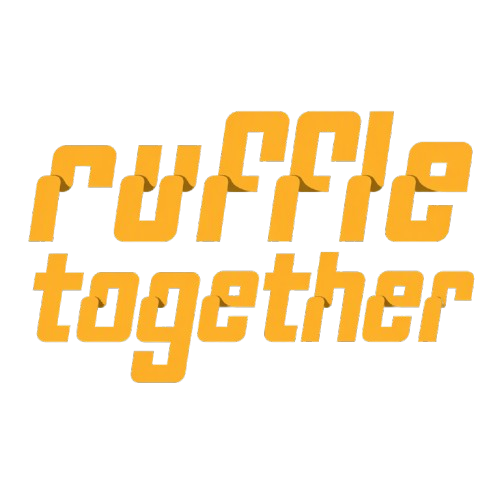

<p align="center">
  
</p>

<p align="center"><b>Play local-multiplayer Flash games online with up to 3 friends.</b></p>

<p align="center">
<a href="https://github.com/multiplayereverything/ruffle-coop/releases/latest">Download</a> ·
<a href="#games">Games</a> ·
<a href="#what-it-does">What it does</a> ·
<a href="#playing">Playing</a> ·
<a href="#for-game-builders">For game builders</a> ·
<a href="#building">Building</a>
</p>

Ruffle Together is a fork of [Ruffle](https://github.com/ruffle-rs/ruffle), the Flash Player emulator written in
Rust. Flash games that two to four people once played on one keyboard become online games: every player runs the same
game on their own PC, and only the key presses and the mouse travel. Every frame runs on every PC with every player's
input, so the games stay identical with nothing else to sync, and the games themselves don't need to change.

The easiest way to play is the **[Multiplayer Mods Launcher](https://github.com/multiplayereverything/multiplayer-mods-launcher/releases/latest)**. It keeps Ruffle Together up to date and starts each game with the right settings.
## Games

Built-in key maps (`--coop-keys <name>`):

| Game | Players | Key map |
|---|---|---|
| Bad Ice-Cream | 2 | `bad-ice-cream` (the default) |
| Gun Mayhem 2 | 2-4 | `gun-mayhem-2` |
| Territory War | 2-4 (hot-seat) | `territory-war` |
| Fireboy & Watergirl in the Forest Temple | 2 | `fireboy-watergirl` |
| Bow Man | 2 | `bow-man` |
| Smileys War | 2-4 | `smileys-war` |
| Stealth Assassin | 2-4 | `stealth-assassin` |
| Stealth Hunter 2 | 2-4 | `stealth-hunter-2` |
| Intrusion / Intrusion 2 | 2-4 | `intrusion`, `intrusion-2` |
| Air Battle | 2-4 | `air-battle` |
| Ultimate Crab Battle | 2-4 | `ultimate-crab-battle` |

Any other game can bring its own key map as a small text file, and games built for Ruffle Together can set their own
from inside the game (Dad 'n Me does).

## What it does

**Playing together**
- 2 to 4 players. Each uses their own normal keys; the host is player 1, friends follow in join order.
- Room codes through the central relay (no IP, no port forwarding), or a direct connection by IP.
- A waiting screen shows the room code, who has joined and how many the game needs. Friends who join early wait as
  long as the last one takes.
- A friend who leaves doesn't end the game: everyone else plays on.
- Chat: press `/`, type, Enter. Names typed into the game's own text boxes reach every PC.

**Fair and in sync**
- Everyone gets the same small input delay, picked from the ping (1 frame on a LAN).
- The games are compared every 25 frames. If they ever differ, every window says so and each PC writes a report to
  find the cause.
- Everyone needs the same game file and the same Ruffle Together version; anything else is refused with the reason.

**Saves**
- Everyone starts from the host's co-op save for that game (its solo save the first time), so unlocked levels carry
  over. Every PC keeps the same co-op save, so anyone can host next time. Solo saves never change.
- `--coop-save solo` or `new` starts from the host's solo save or from nothing.

**Under the hood**
- Lockstep: a frame runs only once every player's input for it has arrived, scheduled a few frames ahead to hide lag.
- The game sees no real time: `getTimer`, `Date`, timers, `Math.random`, sound endings and script limits follow a
  frame clock that is the same everywhere. Window size never reaches the game.
- A heartbeat tells a frozen game from a crash or a closed window, and every PC's log says why a game stopped.

## Get it

| Platform | Status |
|---|---|
| Windows 10 and 11 (64-bit) | [Releases](https://github.com/multiplayereverything/ruffle-coop/releases/latest): unzip, run `ruffle_desktop.exe`, or use the Multiplayer Mods Launcher |
| Linux, macOS | Build from source (not tested yet) |
| Browser | In the works |

## Playing

Host a room on the relay; the window shows a 5-letter code to send your friends:

```
ruffle_desktop --coop-host-relay 165.232.82.11:25569 --coop-players 2 --coop-name Liam Game.swf
ruffle_desktop --coop-join-relay 165.232.82.11:25569 --coop-code ABCDE --coop-name Sam Game.swf
```

Or directly by IP (LAN, a VPN, or a forwarded port):

```
ruffle_desktop --coop-host 7801 --coop-name Liam Game.swf
ruffle_desktop --coop-join <host IP>:7801 --coop-name Sam Game.swf
```

| Option | What it does |
|---|---|
| `--coop-players N` | (host) Start once N players (2-4) have joined |
| `--coop-keys <name or file>` | The key map; everyone uses the same |
| `--coop-save coop\|solo\|new` | (host) Which save everyone starts from |
| `--coop-option NAME=VALUE` | (host) A setting for games that read one, e.g. friendly fire |
| `--coop-delay N` | (host) A fixed input delay in frames instead of the automatic one |

Everything else (the full key-code list, logs, running several windows on one PC) is in the
[user guide](https://github.com/multiplayereverything/ruffle-coop/blob/coop/docs/ruffle-together.md).

## For game builders

Get your game into Ruffle Together, or build a Flash game for it from the start.

1. **Give it a key map.** A text file that says which keys each player's buttons press in the game, and which keys
   a player presses on their own PC:

   ```
   slot 0: UP=38 DOWN=40 LEFT=37 RIGHT=39 FIRE=90 ALT=88
   slot 1: UP=87 DOWN=83 LEFT=65 RIGHT=68 FIRE=84 ALT=89
   local: UP=38,87 DOWN=40,83 LEFT=37,65 RIGHT=39,68 FIRE=90,84 ALT=88,89
   ```

   The number of `slot` lines is how many players the game has; `shared` makes every slot press the same keys
   (hot-seat games). Buttons: `UP DOWN LEFT RIGHT FIRE ALT KEY1-KEY4 VIEW QUIT YES NO MENU`.
2. **Talk to the co-op API.** A game can ask about the players through `ExternalInterface`, in AS2 and AS3:
   - players: `coop.players`, `coop.name(slot)`, `coop.isHost`, `coop.ping(slot)`, `coop.version`, `coop.has(feature)`
   - input: `coop.buttons(slot)`, `coop.button(slot, "FIRE")`, each player's mouse, `coop.typed(slot)`, and
     `coop.keys(text)` to set its own key map
   - the host's settings: `coop.option(name)`, `coop.options`
   - the picture: a camera per player (`coop.camera`), a HUD that stays on screen (`coop.hud`), name tags
     (`coop.label`)
   - events: `coop.events` (join, leave, chat)

   Gameplay must use only shared answers, the same on every PC; `localSlot`, `isHost` and `ping` are for what this
   PC shows. Full reference: [`docs/coop-api.md`](https://github.com/multiplayereverything/ruffle-coop/blob/coop/docs/coop-api.md).
   Drop-in helpers: `tools/coop-api/as2|as3/RuffleTogether.as`. A demo SWF that shows every call:
   `tools/coop-api/demo/`.
3. **Test it without anyone playing.**
   - `--coop-replay <swf> --coop-script <file> --coop-out <file>` runs a game headless from an input script and
     writes a fingerprint every frame; the same script must always give the same file.
   - `tools/coop-lab/lab.py` runs 2-4 headless players on one PC, through a local relay with fake lag or directly.
   - `tools/coop-lab/windows_lab.py` runs two real windows and checks every frame reaches the screen.

## Limits

- Up to 4 players, and no joining a game that has already started.
- The game runs at the speed of the slowest PC.
- If the host leaves, the game ends.

## Building

Ruffle Together lives on the [`coop` branch](https://github.com/multiplayereverything/ruffle-coop/tree/coop).

```
cargo build -p ruffle_desktop --release
COOP_TEST_SWF=<BadIceCream_coop.swf> cargo test -p ruffle_desktop --release
```

The prerequisites are Ruffle's: see its [build instructions](https://github.com/ruffle-rs/ruffle#building-from-source).

## License and credits

Built on [Ruffle](https://github.com/ruffle-rs/ruffle) by the Ruffle team and contributors. Like Ruffle, Ruffle
Together is licensed under either the Apache License, Version 2.0, or the MIT license, at your option. See
[LICENSE.md](LICENSE.md).
